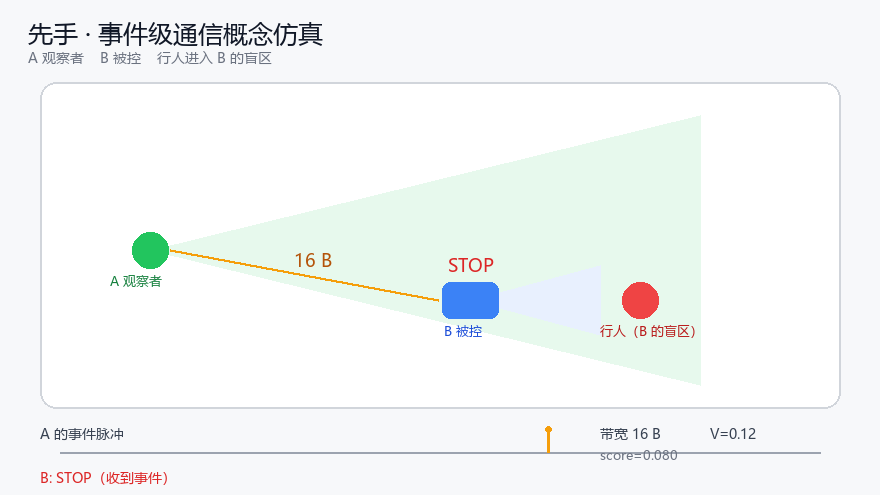

# 先手 · First Move

[](https://github.com/ZangbaoGT/xianshou/actions/workflows/ci.yml)

> 两台机器人，一台替另一台看盲区；只在看见变化时发 16 字节。

**先手** 是一个面向机器人集群的事件级通信演示：A 机器人监测 B 的盲区，检测到显著变化时发送 16 字节事件包；B 在自身视觉看到之前停下或转向。



> 上图由 `sim_swarm.py` 生成，是二维概念仿真；实机视频将在黑客松现场拍摄并替换。动图见 `media/demo.gif`。

## 为什么做这个

- 机器人集群通常共享视频/点云，带宽随规模线性增长；100 台就是 100 份视频。
- 单台机器人有盲区：拐角、货架、人群、遮挡。
- 事件相机只在像素变化时产生数据；通信也应该只在“世界变化”时发生。

**假设**：用 16 字节的稀疏事件替代视频流，可以在几乎不损失集群反应能力的前提下，把带宽降 1–2 个数量级。

## 系统

```text
A（观察者）  相机 → 帧差 → LIF 触发 → 16B UDP
B（被控）    UDP 接收 → 状态机 → 停/转
看板         脉冲、带宽、反应时间
```

- 协议：16 字节，含时间戳、源 ID、事件类型、方位、距离、置信度、序号、CRC16。
- 触发：泄漏积分发放（LIF）神经元；变化累积到阈值才“放电”。
- 通信：UDP，单包 16B；稳定时 0 B/s，变化时约 16 B/事件。
- 控制：B 收到事件后 STOP 1 秒，然后恢复 FORWARD；可替换为 ROS 2 `/cmd_vel` 或厂商 SDK。

## 当前进度

| 模块 | 状态 |
|---|---|
| 16B 协议 + CRC16 | ✅ 已实现，含单元测试 |
| A 的相机/帧差/LIF | ✅ 脚本就绪（`a_perception.py`） |
| B 的接收/状态机 | ✅ 脚本就绪（`b_control.py`） |
| 二维概念仿真 + GIF | ✅ `sim_swarm.py` |
| 两台实机联调 | ⬜ 黑客松现场完成 |
| 20 次 A/B 对照 | ⬜ 黑客松现场完成 |
| 实机视频 | ⬜ 现场拍摄 |

> 说明：仓库里目前是“协议 + 桌面脚本 + 概念仿真”；实机集成与对照实验是现场新增工作。我们不会把仿真说成实机。

## 48 小时计划

- **D1**：两台实机安装、相机/网络配置、跑通 A→B 单包链路。
- **D2**：20 次有/无通信对照，记录反应时间、成功率、带宽；调阈值。
- **D3**：冻结、彩排、录备份视频、提交。

## 硬件

- RDK X5 ×2（或 1 块 + 1 台笔记本）
- 差速底盘 ×2（最低 1 台 + 固定视角）
- USB/CSI 广角相机 ×2
- 5GHz 便携路由 ×1
- 3D 打印相机支架 ×2、遮挡件 ×1
- 软障碍、盲布、插排、网线

## 快速开始

```bash
pip install -r requirements.txt
python sim_swarm.py                          # 生成概念 GIF + 仿真日志
python a_perception.py --camera 0 --dry-run  # 只打印事件，不发网络
python b_control.py --simulate               # 只打印状态
```

有网络时：

```bash
# 终端 1（B）
python b_control.py --listen 0.0.0.0 --port 9000

# 终端 2（A）
python a_perception.py --camera 0 --target 127.0.0.1 --port 9000
```

看板：

```bash
streamlit run dashboard.py
```

## 协议

| 字段 | 字节 | 说明 |
|---|---|---|
| timestamp_ms | 4 | 发送端毫秒时间戳 |
| src_id | 1 | 机器人 ID |
| event_type | 1 | 1=障碍，2=邻居，3=队形，4=心跳 |
| bearing_deg | 2 | 方位 ×10，0–3599 |
| distance_cm | 2 | 距离，厘米 |
| confidence | 1 | 0–100 |
| seq | 1 | 序号，回绕 |
| reserved | 2 | 预留 |
| crc16 | 2 | CRC-16/CCITT |

编码/解码见 `protocol.py`，单测见 `tests/test_protocol.py`。

## 实验设计

详见 [`docs/EXPERIMENT.md`](docs/EXPERIMENT.md)。

- 条件 A：B 蒙眼，单独行动。
- 条件 B：B 蒙眼 + A 的事件。
- 20 次随机时刻，记录：A 检测 → B 停止的时间、是否在安全距离内停下、带宽、误报。
- 预期：条件 B 早 200–300 ms，成功率显著更高，带宽 ~16 B/事件。

## 目录

```text
protocol.py          16B 包编码/解码/CRC
a_perception.py      A：相机 → 帧差 → LIF → UDP
b_control.py         B：UDP → 状态机 → 执行器
sim_swarm.py         二维概念仿真 + GIF
dashboard.py         Streamlit 看板
docs/                一页纸、实验设计、视频脚本
media/               概念图/GIF
tests/               协议单测
```

## 文档

- [一页纸](docs/ONE_PAGER.md)
- [实验设计：20 次 A/B 对照](docs/EXPERIMENT.md)
- [90 秒视频脚本](docs/VIDEO_SCRIPT.md)
- [提交材料（表单用）](SUBMISSION.md)

## 团队

张帅宝（河南科技大学）—— 事件感知、脉冲神经网络、机器人集群。

## License

MIT
